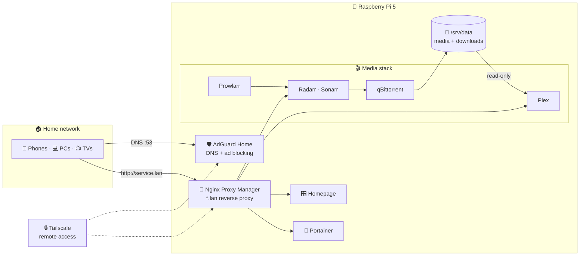

<div align="center">


<a href="#-whats-running">
  
</a>

<br />


<br />


</div>


## 🎛️ What's running

Every service lives in its own folder under [`docker/`](docker/) with a single `compose.yml`.

| | Service | What it does |
|:---:|---|---|
|  | [**AdGuard Home**](docker/adguardhome/compose.yml) | Network-wide DNS with ad and tracker blocking for every device in the house |
|  | [**Nginx Proxy Manager**](docker/nginx-proxy-manager/compose.yml) | Reverse proxy: reach every service by name (`service.lan`) instead of `IP:port` |
|  | [**Homepage**](docker/homepage/compose.yml) | Custom-themed dashboard with live status and stats for every service |
|  | [**Plex**](docker/plex/compose.yml) | Media server for the TVs and phones at home |
|  | [**Radarr**](docker/radarr/compose.yml) | Movie library management |
|  | [**Sonarr**](docker/sonarr/compose.yml) | TV library management and calendar |
|  | [**Prowlarr**](docker/prowlarr/compose.yml) | Indexer manager |
|  | [**qBittorrent**](docker/qbittorrent/compose.yml) | Download client with minimal seeding |
|  | [**FlareSolverr**](docker/flaresolverr/compose.yml) | Helper proxy for Prowlarr *(testing)* |
|  | [**Portainer**](docker/portainer/compose.yml) | Web UI to manage Docker |
|  | [**autoheal**](docker/autoheal/compose.yml) | Restarts any container whose healthcheck fails |

## 🗺️ Architecture



## 🛡️ Security by default

Every stack follows the same rules:

| | Rule |
|:---:|---|
| 👤 | **No root.** Media services run as a dedicated system user: no login shell, no sudo, no Docker access |
| 🔒 | **`no-new-privileges`** and **RAM/CPU limits** wherever possible |
| 🐳 | **`docker.sock` only where strictly needed** (Portainer and autoheal) |
| 📼 | **Read-only media.** Plex mounts the library `:ro`, so it can never modify or delete files |
| ❤️‍🩹 | **Self-healing.** Healthchecks + `autoheal=true` restart anything that hangs |
| 🚪 | **Zero port forwarding.** Nothing is exposed on the router; remote access only through a VPN |
| 🌐 | **LAN only.** Most web UIs are published on IPv4 inside the local network |

## 📁 Repo layout

```
.
├── docker/
│   ├── adguardhome/          compose.yml
│   ├── autoheal/             compose.yml
│   ├── flaresolverr/         compose.yml
│   ├── homepage/
│   │   ├── compose.yml
│   │   ├── homepage.env.example   ← template for the secrets
│   │   └── config/                ← dashboard YAML, CSS theme and JS
│   ├── nginx-proxy-manager/  compose.yml
│   ├── plex/                 compose.yml
│   ├── portainer/            compose.yml
│   ├── prowlarr/             compose.yml
│   ├── qbittorrent/          compose.yml
│   ├── radarr/               compose.yml
│   └── sonarr/               compose.yml
├── .gitignore                ← allowlist: only the files above get published
└── README.md
```

> [!NOTE]
> Each service's runtime state (`config/`, `data/`, `conf/`...) is **not** in this repo: it holds databases, API keys and passwords, and belongs in backups instead.

## 🚀 Quick start

On the server, each stack lives in `~/docker/<service>`:

```bash
cd ~/docker/<service>
docker compose up -d
```

<details>
<summary><b>🎛️ Homepage needs one extra step</b></summary>

<br />

Create the secrets file from the template, lock it down and fill it in:

```bash
cd ~/docker/homepage
cp homepage.env.example homepage.env
chmod 600 homepage.env
nano homepage.env
docker compose up -d
```

> [!WARNING]
> Fill in real credentials before enabling a widget. qBittorrent bans an IP after 5 failed logins, and a misconfigured widget will retry until it gets banned.

</details>

<details>
<summary><b>🔄 Updating a service</b></summary>

<br />

`:latest` images don't update on their own. Pull the new image and recreate the container:

```bash
cd ~/docker/<service>
docker compose pull
docker compose up -d
docker image prune -f
```

</details>

## 🧰 Built with

<p align="center">
  
</p>


