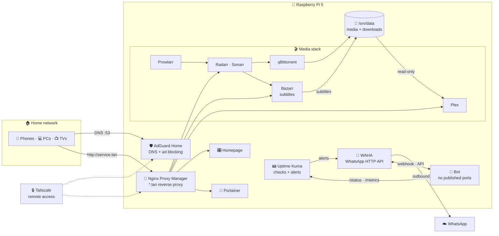

<div align="center">


<a href="#-whats-running">
  
</a>

<br />


<br />


</div>


## 🎛️ What's running

Every service lives in its own folder under [`docker/`](docker/) with a single `compose.yml`, and a root [`docker/compose.yml`](docker/compose.yml) brings them all up with one command.

| | Service | What it does |
|:---:|---|---|
|  | [**AdGuard Home**](docker/adguardhome/compose.yml) | Network-wide DNS with ad and tracker blocking for every device in the house |
|  | [**Nginx Proxy Manager**](docker/nginx-proxy-manager/compose.yml) | Reverse proxy: reach every service by name (`service.lan`) instead of `IP:port` |
|  | [**Homepage**](docker/homepage/compose.yml) | Custom-themed dashboard with live status and stats for every service |
|  | [**Plex**](docker/plex/compose.yml) | Media server for the TVs and phones at home |
|  | [**Radarr**](docker/radarr/compose.yml) | Movie library management |
|  | [**Sonarr**](docker/sonarr/compose.yml) | TV library management and calendar |
|  | [**Bazarr**](docker/bazarr/compose.yml) | Subtitles for the movie and TV library |
|  | [**Prowlarr**](docker/prowlarr/compose.yml) | Indexer manager |
|  | [**qBittorrent**](docker/qbittorrent/compose.yml) | Download client with minimal seeding |
|  | [**FlareSolverr**](docker/flaresolverr/compose.yml) | Helper proxy for Prowlarr |
|  | [**WAHA**](docker/waha/compose.yml) | WhatsApp HTTP API (GOWS engine, no browser) plus a small [bot](docker/waha/bot/index.js) that answers through it (`/status` lists every service's health from Uptime Kuma, `/jitsi` posts a Jitsi meeting link in any chat, `/help` lists the commands) |
|  | [**Uptime Kuma**](docker/uptime-kuma/compose.yml) | Checks every service and sends a WhatsApp alert (via WAHA) when one goes down |
|  | [**Portainer**](docker/portainer/compose.yml) | Web UI to manage Docker |
|  | [**autoheal**](docker/autoheal/compose.yml) | Restarts any container whose healthcheck fails |

## 🗺️ Architecture



## 🛡️ Security by default

Every stack follows the same rules:

| | Rule |
|:---:|---|
| 👤 | **No root.** Media services run as a dedicated system user: no login shell, no sudo, no Docker access |
| 🔒 | **`no-new-privileges`** and **RAM/CPU limits** wherever possible |
| 🐳 | **`docker.sock` only where strictly needed** (Portainer and autoheal) |
| 📼 | **Read-only media.** Plex mounts the library `:ro`, so it can never modify or delete files |
| ❤️‍🩹 | **Self-healing.** Healthchecks + `autoheal=true` restart anything that hangs |
| 🚪 | **Zero port forwarding.** Nothing is exposed on the router; remote access only through a VPN |
| 🌐 | **LAN only.** Most web UIs are published on IPv4 inside the local network |

## 📁 Repo layout

```
.
├── docker/
│   ├── compose.yml           ← root project: includes every stack below
│   ├── adguardhome/          compose.yml
│   ├── autoheal/             compose.yml
│   ├── bazarr/               compose.yml
│   ├── flaresolverr/         compose.yml
│   ├── homepage/
│   │   ├── compose.yml
│   │   ├── homepage.env.example   ← template for the secrets
│   │   └── config/                ← dashboard YAML, CSS theme and JS
│   ├── nginx-proxy-manager/  compose.yml
│   ├── plex/                 compose.yml
│   ├── portainer/            compose.yml
│   ├── prowlarr/             compose.yml
│   ├── qbittorrent/          compose.yml
│   ├── radarr/               compose.yml
│   ├── sonarr/               compose.yml
│   ├── uptime-kuma/          compose.yml
│   └── waha/
│       ├── compose.yml            ← WAHA + the bot
│       ├── waha.env.example       ← template for the API key and passwords
│       ├── bot.env.example        ← template for the bot's key and allowed numbers
│       └── bot/                   ← the bot's code: Dockerfile + index.js
├── .gitignore                ← allowlist: only the files above get published
└── README.md
```

> [!NOTE]
> Each service's runtime state (`config/`, `data/`, `conf/`...) is **not** in this repo: it holds databases, API keys and passwords, and belongs in backups instead.

## 🚀 Quick start

Clone the repo, create the Homepage and WAHA secrets files and start everything from the root project:

```bash
git clone https://github.com/Whuaxu/DjBerry-Homelab.git
cd DjBerry-Homelab/docker

cp homepage/homepage.env.example homepage/homepage.env
chmod 600 homepage/homepage.env
nano homepage/homepage.env        # fill in your keys, passwords and IPs

cp waha/waha.env.example waha/waha.env
cp waha/bot.env.example waha/bot.env
chmod 600 waha/waha.env waha/bot.env
nano waha/waha.env                # API key and dashboard passwords
nano waha/bot.env                 # same API key + numbers allowed to use the bot + Kuma key for /status

docker compose up -d
```

That's it: one project, every stack. The usual commands work for all services at once, or for just one:

| Command | What it does |
|---|---|
| `docker compose up -d` | Start everything |
| `docker compose up -d plex` | Start (or recreate) a single service |
| `docker compose ps` | Status of every container |
| `docker compose logs -f sonarr` | Follow one service's logs |
| `docker compose stop qbittorrent` | Stop a single service |

> [!WARNING]
> Fill in real credentials in `homepage.env` before enabling a widget. qBittorrent bans an IP after 5 failed logins, and a misconfigured widget will retry until it gets banned.

> [!CAUTION]
> `docker compose down` from the root stops **everything**, AdGuard included, so every device on the network loses DNS. Use `docker compose stop <service>` to stop just one.

<details>
<summary><b>🔄 Updating</b></summary>

<br />

`:latest` images don't update on their own. Pull the new images and recreate whatever changed:

```bash
cd DjBerry-Homelab/docker
docker compose pull               # or: docker compose pull plex
docker compose up -d
docker image prune -f             # remove the old images
```

</details>

<details>
<summary><b>📦 Running a single stack on its own</b></summary>

<br />

Every folder is also a standalone Compose project, so you can run just the stacks you want:

```bash
cd DjBerry-Homelab/docker/adguardhome
docker compose up -d
```

> [!IMPORTANT]
> Pick **one** way per service: the root project or its own folder, not both. Services have fixed `container_name` values, so starting the same one from two projects fails with *"container name already in use"*.

</details>

## 🧰 Built with

<p align="center">
  
</p>


